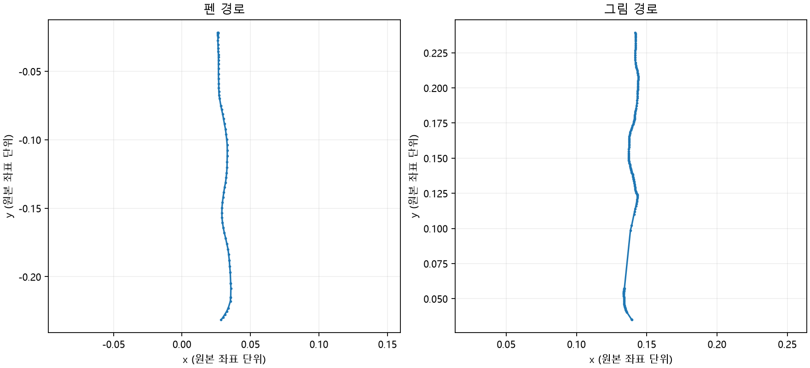
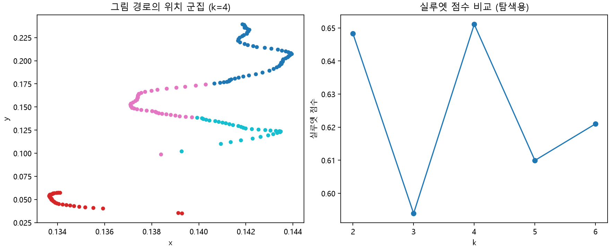
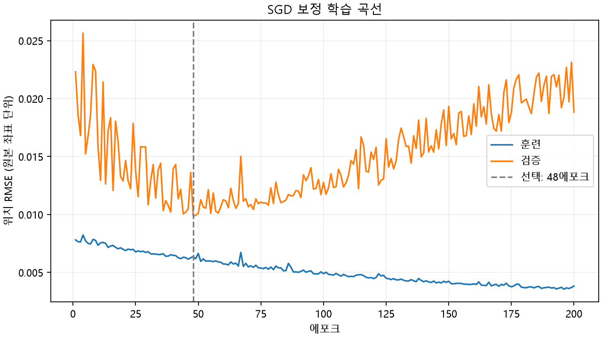
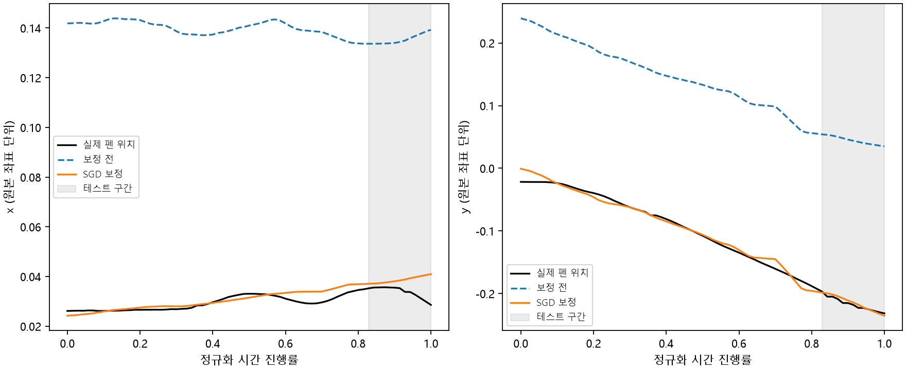

# Week 07

## 🎯 이번 주 목표

- 『혼자 공부하는 머신러닝+딥러닝』 06장 비지도 학습: 군집, k-평균, 주성분 분석(PCA) 정리
- 6주차에 계획한 터치펜 좌표 보정을 실제 측정 숫자에 적용
- SGD 회귀를 30에포크 이상 학습하고, 반복 횟수에 따른 성능과 과대적합 비교
- 원본 데이터, 전처리 가정, 훈련·검증·테스트 결과를 구분하여 재현 가능한 실험 기록 작성

## 📝 스터디 진행상황

- 분석 실행일: **2026.11.28** (스터디 모임 날짜와는 별개)
- 모임 일시·참석자·팀원별 활동: 미제공으로 기재하지 않음
- 학습 범위: 06-1 군집 알고리즘, 06-2 k-평균, 06-3 주성분 분석 및 04-2 확률적 경사 하강법 응용
- 사용 자료: 제공된 `터치펜_데이터.xlsx`, 『혼자 공부하는 머신러닝+딥러닝』 PDF, [6주차 실험계획](../week06/)

### 이번 실험의 핵심 결과

**12개 설정을 각각 200에포크 학습한 뒤, 검증 오차가 가장 작은 48에포크의 2차 다항 SGD 모델을 선택함.** 마지막 테스트 구간 13점에서 위치 RMSE는 보정 전 **0.280705**, 보정 후 **0.007271**로 약 **97.41% 감소**함. 훈련 데이터의 평균 오차만 빼는 기준 모델의 RMSE **0.027202**와 비교해도 약 **73.27% 감소**함.

이 수치는 **두 경로의 정규화 시간 진행률이 같은 지점을 대응시킨다는 가정 아래 계산한 결과**임. 좌표 단위가 확인되지 않아 모든 오차는 **원본 좌표 단위**로 표시함. 새로운 실험 회차나 자석 조건에서의 성능, 물리적 자기장 왜곡 제거율을 뜻하지 않음.

## ✅ 진행상황

- 완료: 엑셀 점검, 진행률 대응, 군집·PCA, 12개 설정의 200에포크 학습, 검증 기반 모델 선택, 테스트 평가, 그래프·코드·수치 기록
- 후속 과제: 공통 좌표계와 단위 확인, 실제 시간 동기화, 여러 궤적·자석·충전 케이스 조건의 독립 평가
- 현재 데이터에 없는 항목: 자기장 세기, 간섭원 거리, 실험 회차 ID, 끊김 정답 라벨. 따라서 Dead Zone 분류와 자석 조건별 성능은 측정하지 않음.

---

## 📚 공부 내용 정리

### 1. 교재 개념을 이번 실험에 연결하기

| 개념 | 교재에서의 역할 | 터치펜 데이터에 적용한 방식 |
|---|---|---|
| 군집 | 정답 없이 비슷한 샘플끼리 묶기 | 인식 좌표가 가까운 구간을 탐색 |
| k-평균 | 가까운 중심에 할당하고 중심을 평균으로 갱신 | 그림 경로의 `(x, y)`를 표준화해 k=2~6 비교 |
| 이너셔 | 각 점과 소속 중심 사이 제곱 거리의 합 | 군집 수에 따른 밀집 정도 비교 |
| PCA | 분산이 큰 방향으로 차원을 축소 | 각 경로의 2차원 좌표를 1차원으로 요약 |
| SGD 회귀 | 손실을 줄이도록 가중치를 반복 갱신 | 인식 좌표에서 실제 위치와의 오차를 예측 |
| 에포크 | 훈련 데이터 전체를 한 번 학습 | x·y 오차 모델이 각각 훈련 42점을 한 번씩 학습 |

군집과 PCA는 경로 구조를 이해하는 **비지도 분석**이고, 실제 위치를 정답으로 사용하는 좌표 보정은 **지도 회귀**임. 군집 번호는 정상·오류 라벨이 아니며, PCA의 분산 보존율도 보정 정확도가 아님.

`KMeans(n_init=30)`은 서로 다른 초기화로 30번 실행한다는 뜻이며 30에포크와 다름. `max_iter=300`도 반복 상한일 뿐 300번을 반드시 수행하지 않음. 이번 에포크 요구는 별도의 SGD 모델에서 충족함. [KMeans 공식 문서](https://scikit-learn.org/stable/modules/generated/sklearn.cluster.KMeans.html)

### 2. 원본 데이터 확인

사용자 확인에 따라 **‘펜 경로’는 실제 펜촉 위치**, **‘그림 경로’는 화면에 인식된 위치**로 해석함.

| 항목 | 펜 경로 | 그림 경로 |
|---|---:|---:|
| 측정 행 수 | 71 | 169 |
| 엑셀 데이터 범위 | A3:C73 | A3:C171 |
| 열 | t, x, y | t, x, y |
| t 시작 | 0 | 0 |
| t 종료 | 2.333333 | 6.994067 |
| 최소 시간 간격 | 0.0000651 | 0.031211 |
| 최대 시간 간격 | 0.06666667 | 0.524933 |
| t·x·y 결측 / 완전 중복 행 | 0 / 0 | 0 / 0 |

첫 행은 제목, 둘째 행은 열 이름이므로 제외함. 그림 경로의 빈 D열은 특성으로 사용하지 않음. 두 경로의 t가 엄격하게 증가하는지 확인했으며, 작은 시간 간격이나 긴 공백은 근거 없이 삭제하지 않음. 긴 시간 간격만으로 필기 끊김을 확정할 수 없음.



원본의 위치와 시작점이 크게 다르므로, 보정 전 오차에는 좌표 원점 차이와 기록 대응 오차가 포함될 수 있음. 이를 모두 자기장 영향이라고 해석하지 않음.

### 3. 두 경로를 대응시키는 전처리

측정 개수와 종료 시간이 달라 같은 행 번호끼리 정답을 붙일 수 없음. 사용자가 승인한 **시작~끝 진행률 대응**을 적용함.

```text
진행률 u = (t - 시작 t) / (종료 t - 시작 t)

실제 위치 P(u) = 펜 경로에 기록된 원래 좌표
인식 위치 D(u) = 같은 u에서 그림 경로를 선형 보간한 좌표
학습할 오차 E(u) = D(u) - P(u)
보정 위치 = D(u) - 예측한 E(u)
```

- 펜 경로의 71개 실제 측정점을 기준으로 삼고, 그림 경로 169점을 그 진행률에 보간함.
- 실제 펜 좌표는 보간하거나 늘리지 않음. 학습용 대응 표본은 **71개**이며, 두 시트 합계 240개를 독립 정답 쌍으로 세지 않음.
- 이 진행률은 **정규화한 시간**이며 누적 이동 거리의 비율이 아님. 두 동작의 상대 속도가 구간마다 다르면 대응이 어긋날 수 있음.
- 시간 정규화에는 전체 기록의 끝점이 필요하므로 현재 분석은 **오프라인 보정 실험**임.

실제 첫 번째 대응점은 다음과 같음.

```text
진행률             = 0
실제 위치 P        = (0.02614860, -0.02173782)
인식 위치 D        = (0.14185620,  0.23935490)
정답 오차 E = D-P  = (0.11570760,  0.26109272)
```

전체 대응 숫자와 분할은 [aligned_data.csv](./results/aligned_data.csv)에 저장함.

### 4. k-평균으로 인식 경로의 구조 살펴보기

그림 경로의 169개 `(x, y)`에 `StandardScaler`를 적용한 뒤, `random_state=42`, `n_init=30`, `max_iter=300`으로 k=2~6을 비교함. 서로 다른 축의 분산을 같은 비중으로 다루므로, 원본 좌표에서의 물리적 거리 군집과는 다를 수 있음.

| k | 이너셔 | 실루엣 점수 | 선택된 실행의 실제 반복 횟수 |
|---:|---:|---:|---:|
| 2 | 109.151879 | 0.648278 | 2 |
| 3 | 50.199516 | 0.593927 | 5 |
| 4 | 25.652176 | **0.651088** | 6 |
| 5 | 19.735155 | 0.609949 | 4 |
| 6 | 15.293746 | 0.621012 | 3 |

실루엣은 군집 내부의 가까움과 다른 군집과의 분리를 함께 보는 지표임. 후보 중 k=4가 가장 높지만 k=2와 차이가 약 0.0028에 불과하므로, 네 가지 오류 유형을 발견했다고 결론 내릴 수 없음. 이너셔는 k가 커지면 대체로 감소하므로 작은 값 하나만으로 k를 결정하지 않음.



군집 그림은 가로 방향 변화를 보기 쉽게 x·y 표시 배율이 서로 다름. 원래 경로의 기하학적 비율은 앞의 원본 경로 그림을 참고함. 이 분석은 전체 기록을 설명하는 탐색용이며, 보정 모델의 입력이나 평가 점수에 사용하지 않음.

### 5. PCA로 경로를 1차원으로 요약하기

각 경로의 원본 `(x, y)`에 `PCA(n_components=1)`을 별도로 적용함. 두 좌표가 같은 단위로 기록되었다는 전제에서, 축별 표준화 없이 평균만 중심화하여 원래 분산 방향을 살펴봄. 단위·좌표계 확인은 후속 과제임.

| 경로 | 첫 번째 주성분의 설명 분산 비율 | 1차원에서 복원한 위치 RMSE |
|---|---:|---:|
| 펜 경로 | 99.9319% | 0.001805 |
| 그림 경로 | 99.8773% | 0.002116 |

두 경로 모두 세로 방향 변화가 커서 하나의 주성분으로 대부분의 분산을 표현할 수 있었음. 다만 작은 가로 변화에 실제 왜곡 정보가 들어 있을 수 있으므로, 높은 분산 보존율만으로 그 정보를 버려도 된다고 판단하지 않음.

복원 RMSE는 **각 경로를 자기 자신의 PCA 복원값과 비교한 값**임. 인식 위치와 실제 펜 위치 사이 보정 오차가 아니며, 이번 보정 모델에는 PCA 축소를 넣지 않음. 군집·PCA는 전체 기록으로 계산한 기술적 분석이고, 아래 회귀의 훈련·검증 분할과는 별개임.

### 6. 학습·검증·테스트 분할

인접 지점이 섞이는 무작위 행 분할을 피하고, 진행 순서대로 앞부분을 학습하고 뒷부분을 평가함.

| 용도 | 펜 경로 원본 엑셀 행 | 대응점 수 | 역할 |
|---|---|---:|---|
| 훈련 | 3~44 | 42 | 스케일러·회귀 가중치 학습 |
| 경계 간격 | 45~46 | 2 | 사용하지 않음 |
| 검증 | 47~58 | 12 | 설정과 에포크 선택 |
| 경계 간격 | 59~60 | 2 | 사용하지 않음 |
| 테스트 | 61~73 | 13 | 선택 완료 후 최종 평가 |

원래 60%·80% 인덱스를 경계로 정한 뒤 검증·테스트 시작의 2점씩을 제외함. 훈련·검증 및 검증·테스트 보간에 사용된 그림 경로 원본 행이 서로 겹치지 않는지도 코드에서 확인함. 특성과 정답의 평균·표준편차는 **훈련 42점만으로 계산**함.

현재는 한 쌍의 기록뿐이므로 이는 **같은 궤적의 뒤쪽 구간에 대한 평가**임. 6주차에 계획한 회차 단위 일반화 평가를 대신하지 못하며, 13개 인접 테스트점을 13번의 독립 실험처럼 해석하지 않음.

### 7. SGD를 200에포크 학습하기

입력은 인식 좌표 `(x, y)`, 정답은 `인식 위치 - 실제 위치`의 x·y 성분임. x 오차와 y 오차를 각각 하나의 `SGDRegressor`로 학습함.

```text
1차 특성: [x, y]
2차 특성: [x, y, x², xy, y²]

특성 생성 → 훈련 데이터로 표준화 → x·y 오차 회귀
→ 정답 표준화를 역변환 → 인식 위치에서 예측 오차 빼기
```

| 설정 | 실험 값 |
|---|---|
| 다항 차수 | 1, 2 |
| 일정 학습률 eta0 | 0.001, 0.01, 0.03 |
| L2 규제 alpha | 0.001, 0.1 |
| 손실 | squared_error |
| 설정 조합 수 | 2 × 3 × 2 = 12 |
| 각 설정 학습 횟수 | 200에포크 |
| 난수 시드 | 42 |
| 선택 기준 | 30~200에포크 중 가장 작은 검증 위치 RMSE |

각 에포크마다 훈련 42점을 시드가 고정된 난수로 섞고, 모델마다 `partial_fit()`을 한 번 호출함. 같은 모델의 가중치를 이어서 갱신하므로 매번 새 모델을 처음부터 훈련하는 방식이 아님. `partial_fit()`의 한 번 호출이 한 에포크에 해당함. [SGDRegressor 공식 문서](https://scikit-learn.org/stable/modules/generated/sklearn.linear_model.SGDRegressor.html)

```python
for epoch in range(1, 201):
    order = rng.permutation(len(train))
    for j, model in enumerate(models):
        model.partial_fit(X[train][order], y_train[order, j])
    # 검증 RMSE를 계산하고, 30에포크 이후의 최적 가중치를 저장
```

선택 결과는 **2차 특성, eta0=0.03, alpha=0.001, 48에포크**임. 200에포크까지 학습 기록을 남긴 후 저장해 둔 48에포크 가중치를 사용함. 실행을 48에포크에서 중단한 것은 아니며, 조기 종료와 같은 취지로 최적 체크포인트를 복원한 것임.

### 8. 반복 횟수별 성능과 과대적합

위에서 선택한 동일 설정에서 에포크만 달리한 결과임. 아래 테스트 열은 모델 선택을 마친 후 계산한 사후 비교이며, 설정이나 에포크 선택에는 사용하지 않음.

| 에포크 | 훈련 위치 RMSE | 검증 위치 RMSE | 테스트 위치 RMSE |
|---:|---:|---:|---:|
| 1 | 0.007812 | 0.022320 | 0.038622 |
| 30 | 0.006788 | 0.010834 | 0.013615 |
| **48 (검증 기준 선택)** | **0.006370** | **0.009869** | **0.007271** |
| 60 | 0.005727 | 0.011281 | 0.008303 |
| 100 | 0.004892 | 0.012760 | 0.017193 |
| 200 | 0.003825 | 0.018832 | 0.034403 |

1에포크에서 30에포크로 늘렸을 때 오차가 줄었음. 그러나 200에포크에서는 훈련 오차는 더 작아지는 반면 검증 오차는 커짐. 따라서 **에포크를 많이 돌리는 것과 일반화 성능이 좋아지는 것은 다름**. 선택 모델의 테스트 오차는 1에포크 모델보다 약 81.17% 작았지만, 이 비율 역시 현재 진행률 대응과 데이터 분할에 한정됨.



12개 설정 전체의 매 에포크 기록 2,400행은 [epoch_history.csv](./results/epoch_history.csv), 각 설정의 최적 검증 결과는 [candidates.csv](./results/candidates.csv)에 있음. 이는 새로운 실험 데이터를 2,400번 수집한 것이 아니라 같은 훈련 자료를 반복 학습한 기록임.

### 9. 보정 전후와 기준 모델 비교

위치 RMSE는 다음 식으로 계산함. x와 y의 개별 RMSE 평균이나 분류 정확도가 아님.

```text
위치 RMSE = sqrt(mean((예측 x - 실제 x)² + (예측 y - 실제 y)²))
오차 감소율 = (1 - 보정 후 RMSE / 비교 기준 RMSE) × 100
```

| 방법 | 훈련 RMSE | 검증 RMSE | 테스트 RMSE |
|---|---:|---:|---:|
| 보정하지 않음 | 0.262783 | 0.271115 | 0.280705 |
| 훈련 평균 오차만 빼기 | 0.009319 | 0.015023 | 0.027202 |
| Ridge 1차 보정 (alpha=1) | 0.007675 | 0.019540 | 0.034998 |
| **2차 SGD, 48에포크** | **0.006370** | **0.009869** | **0.007271** |

평균 이동만으로도 보정 전보다 오차가 크게 줄어듦. 따라서 원본 대비 97.41% 감소만 제시하면 모델의 추가 효과를 과장할 수 있음. 평균 이동 보정 대비 **73.27% 감소**를 함께 확인함. Ridge와 평균 이동 기준 모델도 훈련 세트만으로 학습했으며, 이 네 방법 중 검증 RMSE가 가장 작은 SGD를 최종 선택함.

SGD의 테스트 평균 유클리드 거리 오차는 **0.006716**, 최대 거리 오차는 **0.012915**임. 테스트가 검증보다 오차가 작은 것은 구간 난이도가 다를 수 있기 때문이며, 모든 구간에서 같은 성능을 보장하지 않음.

실제 테스트 첫 지점인 펜 경로 엑셀 61행의 예:

```text
진행률       = 0.82857140
실제 위치    = (0.03524295, -0.19674530)
보정 전      = (0.13367267,  0.05410533)
SGD 보정 후  = (0.03710202, -0.19845716)
```



회색 영역은 테스트 구간임. 시작점 부근이나 마지막 x 좌표에는 잔여 오차가 남으며, 선이 매끄럽다는 이유로 실제 경로를 완전히 복원했다고 판단하지 않음. 모든 테스트 좌표는 [test_predictions.csv](./results/test_predictions.csv)에 있음.

### 10. 결과를 해석할 때 남는 한계

- **시간 대응:** 시작과 끝을 맞췄을 뿐 중간 동작이 실제로 동기화되었다는 증거는 없음. 보정 모델이 시간 대응 오차까지 학습했을 수 있음.
- **단위·좌표계:** 두 경로의 물리적 단위, 원점, 축 방향, 축척이 확인되지 않음. 수치상 변환의 성능이지 mm 단위 물리 오차의 검증이 아님.
- **자료 수:** 정답 쌍은 71개, 최종 테스트는 같은 기록의 13점임. 여러 독립 궤적을 확보한 뒤 회차 단위 분할로 재평가해야 함.
- **모델 선택:** 검증 12점으로 12개 설정과 여러 체크포인트를 비교했으므로 검증 세트에 대한 선택 편향이 생길 수 있음. 시드는 42 하나이며 반복 실험의 신뢰구간은 계산하지 않음.
- **인과관계:** 자기장·거리·자석 종류가 없어 왜곡 원인이나 충전 케이스 조건으로의 일반화를 판단할 수 없음.
- **끊김:** 선형 보간은 서로 다른 표본 시점을 대응시키는 데 사용함. Dead Zone을 식별하거나 미관측 실제 경로의 복원을 검증한 것은 아님.

### 11. 실행 방법과 결과 파일

저장소 루트에서 Python 3.12 환경을 준비한 뒤 실행함. 원본 엑셀과 교재 PDF는 수정하거나 저장소에 복제하지 않음.

```bash
python -m pip install -r week07/requirements.txt
python week07/train_touchpen.py --data "원본 파일 경로/터치펜_데이터.xlsx"
```

별도 결과 폴더를 지정하려면 `--output week07/results_recheck`를 붙임. 원본 파일을 기본 형제 폴더 `../AID_ML_Project/터치펜_데이터.xlsx`에 두면 `--data`를 생략할 수 있음. 실행 시 결과 CSV와 PNG, 환경 정보 JSON을 생성함. 한글 그래프에는 Windows의 맑은 고딕을 사용하며 다른 운영체제에서는 설치된 한글 글꼴로 `font.family`를 변경함.

이번 환경에서는 일반 `python` 명령이 없어 번들 Python 3.12.14를 사용했으며, 추가 라이브러리는 저장소에서 제외한 `.analysis-deps/`에 설치함. 스크립트는 해당 폴더가 있으면 먼저 사용함.

| 파일 | 내용 |
|---|---|
| [train_touchpen.py](./train_touchpen.py) | 전처리, 군집·PCA, 학습·평가·그래프 재현 코드 |
| [requirements.txt](./requirements.txt) | 실행에 사용한 주요 패키지 버전 |
| [aligned_data.csv](./results/aligned_data.csv) | 진행률별 대응 좌표, 오차, 분할 |
| [clusters.csv](./results/clusters.csv), [pca.csv](./results/pca.csv) | 비지도 분석의 실제 수치 |
| [epoch_history.csv](./results/epoch_history.csv) | 12개 설정 × 200에포크의 훈련·검증 기록 |
| [candidates.csv](./results/candidates.csv) | 설정별 최적 검증 체크포인트 |
| [epoch_comparison.csv](./results/epoch_comparison.csv) | 선택 설정의 주요 에포크 비교 |
| [metrics.csv](./results/metrics.csv) | 기준 모델과 SGD의 세트별 오차 |
| [test_predictions.csv](./results/test_predictions.csv) | 테스트 13점의 실제·보정 전·보정 후 좌표 |
| [summary.json](./results/summary.json) | 원본 SHA-256, 데이터 점검, 선택 설정, 패키지 버전 |

### 참고 자료

- 박해선, 『혼자 공부하는 머신러닝+딥러닝』, 06-1~06-3. 제공된 PDF의 인쇄 쪽수 286~337쪽, 특히 k-평균 반복·이너셔 304~311쪽과 PCA·설명 분산 320~326쪽을 참고함. PDF 뷰어 쪽수는 인쇄 쪽수보다 1쪽 큼.
- 교재의 과일 이미지 예제를 터치펜 수치 좌표로 응용함. 위 표의 성능은 교재 예제 수치가 아니라 첨부 엑셀을 실제로 실행한 결과임.
- [KMeans 공식 문서](https://scikit-learn.org/stable/modules/generated/sklearn.cluster.KMeans.html)
- [SGDRegressor 공식 문서](https://scikit-learn.org/stable/modules/generated/sklearn.linear_model.SGDRegressor.html)

---

## 💬 스터디 회고

6주차의 좌표 보정 계획을 실제 숫자에 적용하면서, 모델 선택 전에 두 측정 경로를 어떻게 대응시킬지 정하는 작업이 중요하다는 점을 확인함. 군집과 PCA는 데이터 구조를 설명하는 데 도움이 되었고, 실제 보정에는 정답 위치를 사용하는 회귀가 필요했음.

반복 학습은 초기에 성능을 높였지만 200에포크까지 계속 학습하면 검증 오차가 커졌음. 따라서 학습 횟수 자체보다 검증 곡선과 기준 모델 비교가 중요했음. 개인별 소감은 별도로 제공되지 않아 기재하지 않음.

## ⏭️ 다음 주 계획

- 8주차 인공 신경망 학습에서 같은 분할과 오차 지표로 SGD 다항 회귀와 비교
- 실제 펜 위치와 인식 위치의 시간 동기화·좌표 단위·원점·축척을 확인하여 정답 대응 개선
- 여러 실험 회차와 자기장 조건을 수집하고, 궤적 단위로 분리한 최종 평가 진행
- 끊김 라벨을 추가한 뒤 좌표 회귀와 Dead Zone 분류를 별도로 검증
